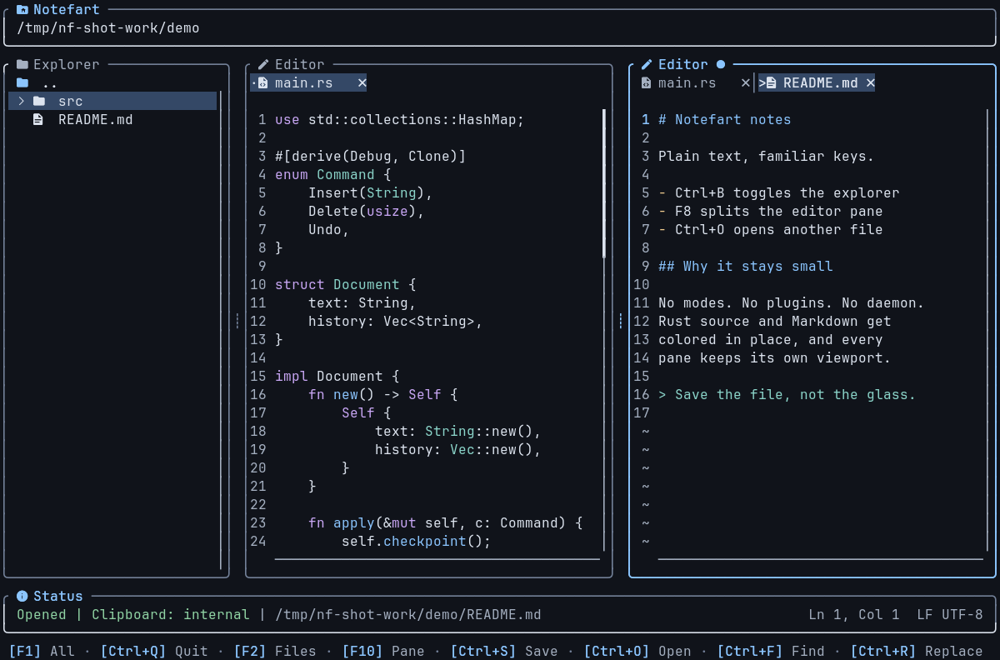

# Notefart

Editor teks terminal yang familiar, tanpa mode editing wajib. Gunakan keyboard atau mouse untuk membuka file, membagi panel, dan mengedit beberapa dokumen dalam satu workspace.

**v0.1.1** adalah versi awal/preview untuk GNU/Linux x86_64. [Binary dan checksum sudah tersedia di Release publik](https://github.com/munMisbah/notefart/releases/tag/v0.1.1).

[Keunggulan](#keunggulan) · [Instalasi](#instalasi) · [Mulai cepat](#mulai-cepat) · [Konfigurasi](#konfigurasi) · [Batasan](#batasan) · [Dokumentasi](#dokumentasi)



*Sesi TUI nyata dengan explorer, split Rust/Markdown dan ikon Nerd Font, dirasterisasi dari buffer terminal. Warna dan font pada terminal Anda dapat berbeda.*

## Keunggulan

- Kontrol editing familiar dengan keyboard dan mouse, tanpa perlu berpindah mode; bantuan lengkap tersedia lewat `F1`.
- Explorer folder yang dapat dibuka atau disembunyikan, dinavigasi dengan keyboard atau mouse, dan diubah lebarnya.
- Tab pada tiap panel dan split kiri–kanan atau atas–bawah. Beberapa view dokumen berbagi teks dan riwayat undo, tetapi memiliki cursor dan viewport sendiri.
- Syntax highlighting untuk berbagai bahasa, termasuk Rust, TypeScript, TSX, dan Markdown; editing mendukung teks Unicode.
- Find/replace, scrollbar, serta pengaturan tema, warna, dan ikon melalui Appearance yang dapat disimpan.

## Instalasi

### Instalasi online

Pada GNU/Linux x86_64, dengan Bash, curl, tar, sha256sum dan coreutils tersedia:

```sh
bash -o pipefail -c 'curl --proto "=https" --proto-redir "=https" -fsSL https://raw.githubusercontent.com/munMisbah/notefart/main/install.sh | bash'
```

Bootstrap mengunduh archive dan checksum dari latest [Release](https://github.com/munMisbah/notefart/releases), memverifikasi checksum, menyiapkan payload dalam direktori sementara privat, lalu menjalankan installer bundle. Kegagalan download atau checksum menghentikan instalasi; `pipefail` meneruskan kegagalan download bootstrap. SHA-256 mendeteksi korupsi, bukan tanda tangan penerbit. Endpoint memerlukan source dan asset Release yang sudah tersedia publik.

Untuk upgrade, gunakan `--replace`; opsi diteruskan ke installer bundle:

```sh
bash -o pipefail -c 'curl --proto "=https" --proto-redir "=https" -fsSL https://raw.githubusercontent.com/munMisbah/notefart/main/install.sh | bash -s -- --replace'
```

Contoh opsi prefix berspasi dan ikon Nerd opt-in:

```sh
bash -o pipefail -c 'curl --proto "=https" --proto-redir "=https" -fsSL https://raw.githubusercontent.com/munMisbah/notefart/main/install.sh | bash -s -- --prefix "$HOME/My Apps" --theme terminal --icons nerd'
```

Nerd Font harus disediakan dan dipilih sendiri di terminal; installer tidak memasang font. Opsi lain: `--skip-config`, `--color auto|truecolor|256|16|none` dan `--clipboard auto|internal|system`. Gunakan `bash install.sh --help` untuk bantuan tanpa jaringan.

### Bundle offline atau build source

Unduh `naf-linux-x86_64.tar.gz` dan `naf-linux-x86_64.tar.gz.sha256` dari [Release v0.1.1](https://github.com/munMisbah/notefart/releases/tag/v0.1.1). Alternatif artifact CI tersedia di [Actions](https://github.com/munMisbah/notefart/actions): artifact berupa ZIP browser; ekstrak ZIP terlebih dahulu untuk mendapatkan kedua file.

**Dari source:** clone repository, lalu build dengan Rust/Cargo melalui [rustup](https://rustup.rs), compiler C, dan `pkg-config` yang tersedia. `rust-toolchain.toml` memilih Rust 1.99.1; rustup akan mengunduhnya bila diperlukan.

```sh
git clone --branch v0.1.1 --depth 1 https://github.com/munMisbah/notefart.git
cd notefart
cargo build --locked --release --bin naf
bash scripts/package.sh --binary target/release/naf --output "$HOME/naf-dist"
```

Kedua file bundle berada di `$HOME/naf-dist`. Gunakan direktori output yang dimiliki akun Anda.

### Verifikasi dan pasang bundle offline

Masuk ke direktori yang berisi kedua file; untuk hasil build source, gunakan `cd "$HOME/naf-dist"`. Verifikasi sebelum mengekstrak atau menjalankan installer:

```sh
sha256sum -c naf-linux-x86_64.tar.gz.sha256
tar -xzf naf-linux-x86_64.tar.gz
./naf-linux-x86_64/install.sh
```

Lanjutkan hanya jika checksum cocok. Checksum mendeteksi perubahan isi, tetapi bukan tanda tangan atau bukti keaslian; dapatkan bundle dan checksum dari sumber yang Anda percayai.

Installer tidak memerlukan `sudo` untuk instalasi user-local. Binary dipasang ke `~/.local/bin/naf`, sedangkan contoh konfigurasi dan notice ke `~/.local/share/notefart`. Installer tidak mengubah `PATH`. Jika `~/.local/bin` belum ada di `PATH`, aktifkan untuk shell ini:

```sh
export PATH="$HOME/.local/bin:$PATH"
naf --version
```

Tambahkan baris `export` tersebut ke konfigurasi shell Anda agar berlaku pada sesi berikutnya. Untuk prefix lain, gunakan `--prefix /path/absolut` dan tambahkan `PREFIX/bin` ke `PATH`.

### Upgrade bundle offline

Dapatkan dan verifikasi bundle baru dengan langkah yang sama, lalu jalankan installer dari bundle hasil ekstraksi dengan `--replace`:

```sh
./naf-linux-x86_64/install.sh --replace
```

Installer mempertahankan konfigurasi yang sudah ada, termasuk saat upgrade. Percayai direktori prefix dan konfigurasi beserta seluruh parent-nya; alias direktori symlink tetap diikuti. Instalasi sistem memerlukan prefix eksplisit dan `--skip-config`; lihat [panduan teknis](docs/README.md) sebelum menggunakan hak administrator.

## Mulai cepat

```sh
naf                 # pulihkan sesi normal terakhir atau buka workspace kosong
naf catatan.txt     # buka file; explorer awalnya tersembunyi
naf ./folder        # buka folder di explorer
naf --no-session    # jalankan tanpa membaca atau menulis snapshot sesi default
```

`naf` tanpa path menampilkan explorer dan memulihkan snapshot dari exit normal jika tersedia. `naf FILE` atau `naf DIR` tidak membaca atau menulis snapshot default. Gunakan `naf --help` untuk opsi lengkap.

| Tombol | Aksi |
| --- | --- |
| `F1` | Bantuan lengkap |
| `Ctrl+O` / `Ctrl+N` | Buka path / tab baru |
| `Ctrl+S` / `F4` | Simpan / Save As |
| `Ctrl+Q` | Keluar; pada sesi default, simpan snapshot sesi |
| `Ctrl+Z` / `Ctrl+Y` | Undo / redo |
| `Ctrl+F` / `Ctrl+R` | Cari / ganti teks |
| `Ctrl+B` / `F2` | Tampilkan atau sembunyikan explorer / pindah fokus |
| `F8` / `F9` | Split kiri–kanan / atas–bawah |
| `F10` / `F12` | Panel berikutnya / tutup panel |
| `Alt+P` | Buka Appearance |

## Konfigurasi

Bawaan aplikasi adalah tema `dark`, warna `auto`, ikon `unicode`, dan clipboard `auto`. Preferensi dibaca dari `$XDG_CONFIG_HOME/notefart/config.toml` jika `XDG_CONFIG_HOME` absolut; jika tidak, dari `$HOME/.config/notefart/config.toml`. Contoh dan pilihan tersedia di [config.toml.example](config.toml.example); file contoh di repository tidak dibaca otomatis.

Buka Appearance dengan `Alt+P`, lalu pilih **Apply** untuk menyimpan tema, warna, dan ikon. Flag CLI mengungguli konfigurasi tersimpan. Dengan `--no-config`, Appearance hanya berlaku untuk sesi berjalan. Penyimpanan konfigurasi eksplisit menulis TOML kanonik dan tidak mempertahankan komentar.

Ikon Nerd Font adalah pilihan opt-in. Atur Nerd Font di terminal, lalu simpan preferensi dengan:

```sh
naf --icons nerd --save-config
```

Perintah tersebut menyimpan konfigurasi dan keluar; jalankan `naf` kembali untuk membuka editor. Profil `unicode` dan `ascii` tersedia tanpa Nerd Font. Font, bentuk glyph, warna dan perilaku shortcut juga bergantung pada terminal dan window manager.

Latar kanvas mengikuti terminal; transparansi dan blur diatur di terminal, bukan oleh Notefart.

## Batasan

- Bundle awal ditujukan untuk GNU/Linux x86_64; binary bergantung pada ABI/glibc yang kompatibel, bukan binary static universal. Windows dan macOS belum disediakan.
- File dibaca sebagai UTF-8 dengan batas load/save 64 MiB. LF, CRLF, dan BOM didukung; newline campuran atau lone CR hanya baca. UTF-8 tidak valid, NUL, dan file non-regular ditolak.
- Notefart adalah editor teks, bukan IDE: LSP/autocomplete, debugger, plugin, terminal embedded, soft wrap, dan encoding tambahan belum tersedia.
- Snapshot sesi dari exit normal **bukan autosave atau crash recovery** dan tidak menyimpan file sumber. Snapshot dapat memuat teks belum disimpan dalam plaintext tanpa enkripsi; gunakan `--no-session` untuk tidak menyentuh snapshot default.
- Clipboard sistem memerlukan helper lokal: `wl-copy` dan `wl-paste` untuk Wayland atau `xclip` untuk X11. Dalam SSH, mode `auto` menggunakan clipboard internal; OSC 52 belum tersedia.
- Tag Git saja tidak menyediakan binary. Workflow Release menghasilkan draft yang perlu dipublikasikan secara manual; jangan menganggap asset publik tersedia sebelum memeriksanya.

## Dokumentasi

- [Panduan teknis](docs/README.md) — instalasi lanjutan, interaksi, konfigurasi, dan verifikasi.
- [Keamanan dan integritas file](docs/SECURITY.md) · [Arsitektur](docs/ARCHITECTURE.md) · [Roadmap](docs/ROADMAP.md)
- [Changelog](CHANGELOG.md) · [GitHub Actions](https://github.com/munMisbah/notefart/actions) · [Releases](https://github.com/munMisbah/notefart/releases)

## Lisensi

Lisensi proyek belum ditetapkan. Notice dependency yang disertakan dalam bundle tidak menetapkan lisensi untuk proyek Notefart.
